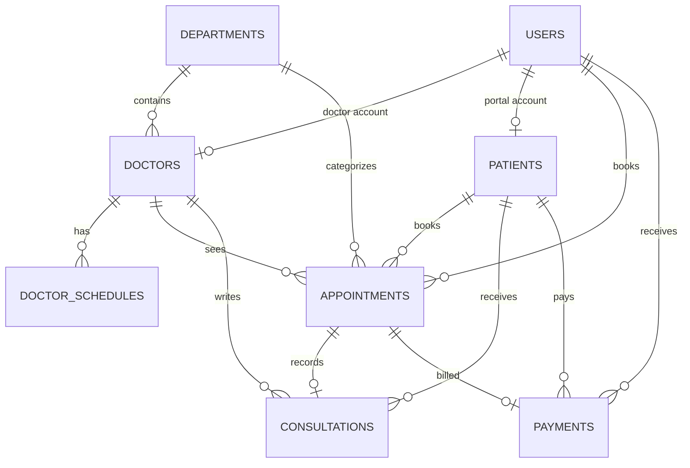

# CityCare Medical Centre

CityCare is a responsive Laravel application for managing clinic departments, doctors, weekly schedules, patients, appointments, consultations, payments and management reports. The application uses role and permission checks at route, policy and view level.

## Features by role

- **Admin:** all clinic records, users created through doctor and patient workflows, clinic reports and exports.
- **Receptionist:** patient records, doctor directory, appointment booking and daily appointment reports.
- **Doctor:** own appointments, treated patient history, consultations, workload and attendance reports for their own appointments.
- **Cashier:** appointment billing, partial payments, balance tracking, receipts and payment reports.
- **Patient:** own profile, appointment list, visit history and payment status.

Public registration is disabled. Staff create patient records and may create a patient portal account for them. Seeded demo users share the password `password`; change these credentials before using a deployed environment.

## Stack

- Laravel 13, PHP 8.5 (PHP 8.3+ is required by the installed Laravel Excel 4 package)
- Laravel Breeze with Blade, Tailwind CSS, Alpine.js and Vite
- MySQL or SQLite, with portable Laravel migrations
- Spatie Laravel Permission for roles and permissions
- Laravel Excel for XLSX and CSV exports
- DomPDF for PDF reports and payment receipts
- PHPUnit feature tests

## Requirements

Install PHP with the extensions required by Laravel and Composer dependencies, Composer, Node.js and npm. MySQL is optional; SQLite is configured by default. For a fresh SQLite database, ensure `database/database.sqlite` exists and is writable.

## Local setup

```sh
composer install
npm install
copy .env.example .env
php artisan key:generate
php artisan migrate --seed
npm run build
php artisan serve
```

On PowerShell, `Copy-Item .env.example .env` can be used instead of `copy`. The default `.env.example` uses SQLite, `Africa/Kampala`, UGX and the database session/cache/queue drivers. To use MySQL, set `DB_CONNECTION=mysql`, host, port, database, username and password in `.env` before migrating. The database must already exist.

The SQLite database is seeded with five clinic departments, eight doctors and their weekday schedules, 50 patient records, 150 appointments, consultations for completed visits, and payment records. Seeded appointments span past and future dates.

### Demo accounts

| Role | Email |
| --- | --- |
| Admin | `admin@citycare.test` |
| Receptionist | `reception@citycare.test` |
| Doctor | `doctor@citycare.test` |
| Cashier | `cashier@citycare.test` |
| Patient | `patient@citycare.test` |

The demo patient portal is linked to a seeded patient record. The seeder also creates additional doctor accounts (`doctor2@citycare.test` through `doctor8@citycare.test`). All use `password`.

## Core rules

- Appointment times must match an active doctor schedule and be in the future.
- Doctor and patient appointments cannot overlap. Booking rechecks the constraints inside a database transaction while holding doctor/date and patient/date cache locks.
- Doctor schedule intervals cannot overlap for the same doctor and weekday.
- Patient phone and date of birth are unique together; likely duplicates are shown during patient entry.
- Patients and appointments use soft deletes where history must remain available.
- Payments are cumulative per appointment: subsequent entries add to the recorded amount, partial balances remain visible, and overpayment is rejected.
- Patient, doctor, consultation and payment policies scope records to the signed-in person where applicable.

## Reports and AJAX endpoints

Reports are available under `/reports` for daily appointments, doctor workload, payments, patient visit history and attendance trends. Results can be downloaded as PDF, XLSX or CSV. Doctor workload and patient history reports restrict results to the signed-in doctor's own records.

Authenticated JSON endpoints:

- `GET /api/doctors/{doctor}/available-slots?date=YYYY-MM-DD` returns future, unbooked schedule slots and the free-slot count. Appointment rescheduling may pass `appointment_id` to exclude its current slot.
- `GET /api/patients/search?q=...` returns up to ten patient matches for appointment and payment forms.
- `GET /api/departments/{department}/doctors` returns active doctors in a department.

The endpoints use the same authenticated session and permissions as the corresponding screens.

## Data model



`users` also has Spatie role/permission pivot tables. Appointments and patients are soft-deletable. Payments are one record per appointment, with partial receipts accumulated in `amount_paid`.

## Verification

```sh
php artisan migrate:fresh --seed --no-interaction
php artisan test --compact
npm run build
php artisan route:list --except-vendor
php artisan optimize:clear
vendor/bin/pint --dirty --format agent
```

The feature suite covers role dashboards, authentication and registration policy, appointment booking and slot availability, payment balances, patient data isolation, and report exports.
