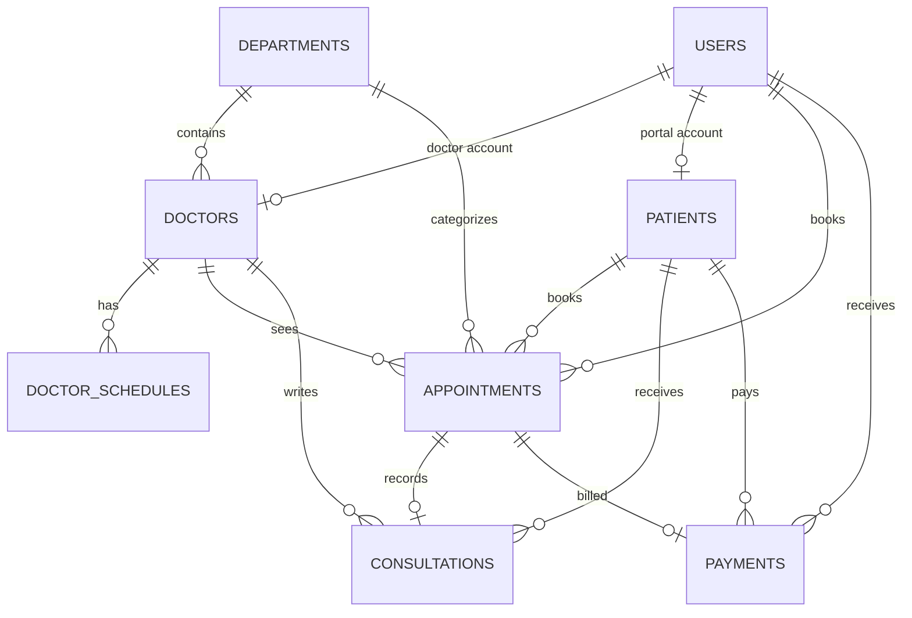

# CityCare Medical Centre

CityCare is a responsive Laravel application for managing clinic departments, doctors, weekly schedules, patients, appointments, consultations, pharmacy, payments and management reports. The application uses role and permission checks at route, policy and view level.

## Features by role

- **Admin:** all clinic records, users created through doctor and patient workflows, clinic reports and exports.
- **Receptionist:** patient records, doctor directory, appointment booking and daily appointment reports.
- **Doctor:** own weekly schedule and appointments, treated patient history, consultations, workload and attendance reports for their own appointments.
- **Cashier:** appointment and medication billing, partial payments, balance tracking, downloadable payment receipts and payment reports.
- **Pharmacist:** medicine catalogue and stock, prescription review, medication fee creation, dispensing and patient clearance.
- **Patient:** own profile, appointment list, visit history and payment status.

Consultation fees and medication bills are separate. Doctors can add structured medicines and quantities to a consultation. A pharmacist reviews stock and the medicines to supply; those items are priced separately from the appointment fee. Patients can pay medication balances through the patient portal or a cashier can record clinic payments. Dispensing and pharmacy clearance remain locked until the complete medication fee is paid and every prescribed item has a final outcome. A downloadable PDF receipt is available for each completed payment transaction.

To load the optional Uganda starter medicine catalogue without seeding demo users or appointments, run `php artisan db:seed --class=UgandaStarterMedicinesSeeder`. Admins can change a doctor's consultation fee at any time from **Clinic pricing**; new bookings use the updated fee while existing appointments keep their recorded fee.

Laboratory services use the `lab-technician` role. Run `php artisan db:seed --class=RolesAndPermissionsSeeder` to refresh roles and permissions, then seed the starter test catalogue with `php artisan db:seed --class=UgandaStarterLabTestsSeeder`. Doctors can add referrals during consultation, while patients can book a consultation or book specific tests from **My appointments**. Lab invoices appear with other balances in **My payments**; laboratory staff can collect/process and finalize results only after the full laboratory bill is paid. Referral results and invoice are attached to the appointment, and pharmacy clearance checks that linked tests are completed and all visit balances are settled.

Public registration is disabled. Staff create patient records and may create a patient portal account for them. Seeded demo users share the password `password`; change these credentials before using a deployed environment.

## Stack

- Laravel 13, PHP 8.5 (PHP 8.3+ is required by the installed Laravel Excel 4 package)
- Laravel Breeze with Blade, Tailwind CSS, Alpine.js and Vite
- MySQL by default, with SQLite available as a local fallback and portable Laravel migrations
- Spatie Laravel Permission for roles and permissions
- Laravel Excel for XLSX and CSV exports
- DomPDF for PDF reports and payment receipts
- Chart.js for role-scoped dashboard charts
- Toastify.js for status, warning and error notifications; Font Awesome 4.7 for interface icons
- PHPUnit feature tests

## Interface and framework components

- **Breeze authentication:** login and account views live in `resources/views/auth`; the guest and signed-in shells are Blade components in `resources/views/layouts` and `resources/views/components`; auth routes are loaded from `routes/auth.php`.
- **Spatie roles and permissions:** `app/Models/User.php` uses `HasRoles`, `bootstrap/app.php` registers the `role` and `permission` middleware aliases, and route/view access checks use those roles and permissions.
- **Laravel API resources:** `app/Http/Resources` formats the patient search, doctor option and available-slot JSON responses used by the booking forms.
- **Toast notifications:** `resources/js/app.js` exposes `CityCareToast`; application shells send session feedback and validation summaries through Toastify.
- **Brand assets:** `public/images/citycare-mark.svg` is used throughout the application, and `public/favicon.svg` supplies the browser icon.
- **Profile photos:** JPEG, PNG and WebP images are limited to 2 MB and 96–2000 pixels per dimension; upload files use generated filenames on the private local disk and are streamed only to the signed-in account.
- **Dashboard charts:** appointment activity and status are scoped to the signed-in doctor or patient; payment collection charts are shown only for administrators and cashiers.

## Requirements

Install PHP with the extensions required by Laravel and Composer dependencies, Composer, Node.js and npm. MySQL is the default connection. For a local SQLite fallback, set `DB_CONNECTION=sqlite` and set `DB_DATABASE` to the absolute path of a writable SQLite file.

## Local setup

```sh
composer install
npm install
copy .env.example .env
php artisan key:generate
php artisan migrate --seed
npm run build
php artisan serve
```

On PowerShell, `Copy-Item .env.example .env` can be used instead of `copy`. The default `.env.example` targets XAMPP MySQL at `127.0.0.1:3306`, database `CityCare_db`, user `root`, and a blank password. Set the username/password in `.env` if your MySQL installation differs. Create the database before migrating. The application timezone is `Africa/Kampala` and currency is UGX.

The SQLite database is seeded with five clinic departments, eight doctors and their weekday schedules, 50 patient records, 150 appointments, consultations for completed visits, and payment records. Seeded appointments span past and future dates.

### Demo accounts

| Role | Email |
| --- | --- |
| Admin | `admin@citycare.test` |
| Receptionist | `reception@citycare.test` |
| Doctor | `doctor@citycare.test` |
| Cashier | `cashier@citycare.test` |
| Patient | `patient@citycare.test` |

The demo patient portal is linked to a seeded patient record. The seeder also creates additional doctor accounts (`doctor2@citycare.test` through `doctor8@citycare.test`). All use `password`.

## Core rules

- Appointment times must match an active doctor schedule and be in the future.
- Doctor and patient appointments cannot overlap. Booking rechecks the constraints inside a database transaction while holding doctor/date and patient/date cache locks.
- Doctor schedule intervals cannot overlap for the same doctor and weekday.
- Patient phone and date of birth are unique together; likely duplicates are shown during patient entry.
- Patients and appointments use soft deletes where history must remain available.
- Payments are cumulative per appointment: subsequent entries add to the recorded amount, partial balances remain visible, and overpayment is rejected.
- Patient, doctor, consultation and payment policies scope records to the signed-in person where applicable.

## Reports and AJAX endpoints

Reports are available under `/reports` for daily appointments, doctor workload, payments, patient visit history and attendance trends. Results can be downloaded as PDF, XLSX or CSV. Doctor workload and patient history reports restrict results to the signed-in doctor's own records.

Authenticated JSON endpoints:

- `GET /api/doctors/{doctor}/available-slots?date=YYYY-MM-DD` returns future, unbooked schedule slots and the free-slot count. Appointment rescheduling may pass `appointment_id` to exclude its current slot.
- `GET /api/patients/search?q=...` returns up to ten patient matches for appointment and payment forms.
- `GET /api/departments/{department}/doctors` returns active doctors in a department.

The endpoints use the same authenticated session and permissions as the corresponding screens.

## Data model



`users` also has Spatie role/permission pivot tables. Appointments and patients are soft-deletable. Payments are one record per appointment, with partial receipts accumulated in `amount_paid`.

## Verification

```sh
php artisan migrate:fresh --seed --no-interaction
php artisan test --compact
npm run build
php artisan route:list --except-vendor
php artisan optimize:clear
vendor/bin/pint --dirty --format agent
```

The feature suite covers role dashboards, authentication and registration policy, appointment booking and slot availability, payment balances, patient data isolation, and report exports.
