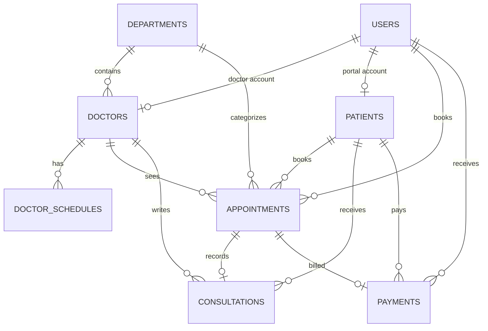

# CityCare Medical Centre

CityCare is a responsive Laravel application for managing clinic departments, doctors, weekly schedules, patients, appointments, consultations, payments and management reports. The application uses role and permission checks at route, policy and view level.

## Features by role

- **Admin:** all clinic records, users created through doctor and patient workflows, clinic reports and exports.
- **Receptionist:** patient records, doctor directory, appointment booking and daily appointment reports.
- **Doctor:** own weekly schedule and appointments, treated patient history, consultations, workload and attendance reports for their own appointments.
- **Cashier:** appointment billing, partial payments, balance tracking, receipts and payment reports.
- **Patient:** own profile, appointment list, visit history and payment status.

Public registration is disabled. Staff create patient records and may create a patient portal account for them. Seeded demo users share the password `password`; change these credentials before using a deployed environment.

## Stack

- Laravel 13, PHP 8.5 (PHP 8.3+ is required by the installed Laravel Excel 4 package)
- Laravel Breeze with Blade, Tailwind CSS, Alpine.js and Vite
- MySQL by default, with SQLite available as a local fallback and portable Laravel migrations
- Spatie Laravel Permission for roles and permissions
- Laravel Excel for XLSX and CSV exports
- DomPDF for PDF reports and payment receipts
- Chart.js for role-scoped dashboard charts
- Toastify.js for status, warning and error notifications; Font Awesome 4.7 for interface icons
- PHPUnit feature tests

## Interface and framework components

- **Breeze authentication:** login and account views live in `resources/views/auth`; the guest and signed-in shells are Blade components in `resources/views/layouts` and `resources/views/components`; auth routes are loaded from `routes/auth.php`.
- **Spatie roles and permissions:** `app/Models/User.php` uses `HasRoles`, `bootstrap/app.php` registers the `role` and `permission` middleware aliases, and route/view access checks use those roles and permissions.
- **Laravel API resources:** `app/Http/Resources` formats the patient search, doctor option and available-slot JSON responses used by the booking forms.
- **Toast notifications:** `resources/js/app.js` exposes `CityCareToast`; application shells send session feedback and validation summaries through Toastify.
- **Brand assets:** `public/images/citycare-mark.svg` is used throughout the application, and `public/favicon.svg` supplies the browser icon.
- **Profile photos:** JPEG, PNG and WebP images are limited to 2 MB and 96–2000 pixels per dimension; upload files use generated filenames on the private local disk and are streamed only to the signed-in account.
- **Dashboard charts:** appointment activity and status are scoped to the signed-in doctor or patient; payment collection charts are shown only for administrators and cashiers.

## Requirements

Install PHP with the extensions required by Laravel and Composer dependencies, Composer, Node.js and npm. MySQL is the default connection. For a local SQLite fallback, set `DB_CONNECTION=sqlite` and set `DB_DATABASE` to the absolute path of a writable SQLite file.

## Local setup

```sh
composer install
npm install
copy .env.example .env
php artisan key:generate
php artisan migrate --seed
npm run build
php artisan serve
```

On PowerShell, `Copy-Item .env.example .env` can be used instead of `copy`. The default `.env.example` targets XAMPP MySQL at `127.0.0.1:3306`, database `CityCare_db`, user `root`, and a blank password. Set the username/password in `.env` if your MySQL installation differs. Create the database before migrating. The application timezone is `Africa/Kampala` and currency is UGX.

The SQLite database is seeded with five clinic departments, eight doctors and their weekday schedules, 50 patient records, 150 appointments, consultations for completed visits, and payment records. Seeded appointments span past and future dates.

## Deploy to Wasmer Edge

The repository includes `wasmer.toml` for Wasmer's PHP 8.3 runtime and `app.yaml` for the managed MySQL database, production settings, single-concurrency PHP runtime, persistent private profile-photo storage, and a pre-deployment migration job. Replace `owner` in `app.yaml` with your Wasmer username or organization before connecting the repository. Wasmer currently offers its managed database and volumes in `fr-roub1`, so this configuration runs CityCare and stores its database and uploaded profile photos in France. Review your organization's data residency requirements before deploying real patient information.

### 1. Prepare the GitHub branch

Push the project to GitHub and choose the branch Wasmer should deploy, usually `main`. Wasmer detects PHP projects and installs Composer dependencies from `composer.json` and `composer.lock`. This Laravel app also needs Vite's compiled assets. Build those locally before pushing and include `public/build` in the commit; `.gitignore` is configured to allow those built assets:

```powershell
npm ci
npm run build
git add public/build
git add .gitignore README.md app.yaml wasmer.toml config/database.php config/wasmer.php app/Console/Commands/PrepareWasmerDeployment.php database/seeders/WasmerAdminSeeder.php
git commit -m "Prepare CityCare for Wasmer deployment"
git push origin main
```

Run these commands from the project root, replacing `main` if your production branch has a different name. Rebuild and commit `public/build` whenever frontend source files change.

### 2. Create the Wasmer app and configure secrets

Create an Edge app in Wasmer and set its secrets and environment variables in the app dashboard before the first deployment:

- `APP_KEY`: generate one locally with `php artisan key:generate --show`, then paste the value into the secret field. Do not commit it.
- `WASMER_ADMIN_EMAIL`: email address for the first production administrator.
- `WASMER_ADMIN_PASSWORD`: a unique password of at least 16 characters. Generate a strong value and store it only as a Wasmer secret.
- `WASMER_ADMIN_NAME`: administrator's display name (optional; defaults to `CityCare Administrator`).
- `APP_URL`: the HTTPS URL Wasmer assigns to the app.
- `APP_ENV`: `production`.
- `APP_DEBUG`: `false`.
- `LOG_CHANNEL`: `stderr`.
- `MAIL_MAILER`: `smtp` (the app uses email for login OTP and password reset codes).
- `MAIL_HOST`: `smtp.gmail.com`.
- `MAIL_PORT`: `587`.
- `MAIL_SCHEME`: `tls`.
- `MAIL_USERNAME`, `MAIL_PASSWORD`, and `MAIL_FROM_ADDRESS`: the clinic's sending account and its app password, stored as secrets.
- `MAIL_FROM_NAME`: `CityCare Medical Centre`.

Wasmer provisions the MySQL database from `app.yaml` and exposes `DB_HOST`, `DB_PORT`, `DB_NAME`, `DB_USERNAME`, and `DB_PASSWORD`. Laravel's MySQL configuration accepts Wasmer's `DB_NAME` as a fallback for `DB_DATABASE`. Do not set local XAMPP credentials in Wasmer. Laravel compiles Blade views under `/tmp` and writes application logs to standard error so the Wasmer runtime can collect them; the admin system-log screen reads local Laravel log files and therefore may not show Wasmer's platform logs.

### 3. Connect the GitHub repository

In the Wasmer app, open **Settings → Git**, choose **GitHub**, authorize Wasmer for the repository (and organization if applicable), then select this repository and the production branch. Save the connection and start the first deployment. Keep `.env` out of Git; Wasmer app secrets supply production values. Wasmer Git deployments use the selected production branch, and future pushes to it deploy updates.

The pre-deployment job runs `php artisan wasmer:prepare` against the managed database. That command migrates the schema, creates the standard roles and permissions on a fresh database, and creates the first administrator using the Wasmer secrets. It is safe to run on later deployments: it does not reset an existing administrator's password or role customizations. Do not run the general `db:seed` command in production; the clinic demo seeder creates sample users and clinical records. After the first deployment, check the assigned HTTPS URL, verify login and OTP email delivery, test a profile-photo upload, and review the app's logs and database in the Wasmer dashboard.

For later releases, build the Vite assets, commit the resulting `public/build` files with the source change, and push to the connected branch. Wasmer then deploys from GitHub. Wasmer's Git integration connects the repository and branch to the app; the PHP detector installs Composer dependencies, while committing `public/build` makes this app's Vite output available to Laravel.

Wasmer references: [GitHub deployments](https://docs.wasmer.io/edge/git/wasmer-for-github/), [Git deployment overview](https://docs.wasmer.io/edge/git/), [Laravel on Wasmer](https://docs.wasmer.io/edge/guides/laravel/), [supported frameworks and automatic dependency detection](https://docs.wasmer.io/edge/learn/supported-frameworks-and-languages/), [app configuration and managed databases](https://docs.wasmer.io/edge/configuration/), and [regions](https://docs.wasmer.io/edge/learn/regions/).

### Demo accounts

| Role | Email |
| --- | --- |
| Admin | `admin@citycare.test` |
| Receptionist | `reception@citycare.test` |
| Doctor | `doctor@citycare.test` |
| Cashier | `cashier@citycare.test` |
| Patient | `patient@citycare.test` |

The demo patient portal is linked to a seeded patient record. The seeder also creates additional doctor accounts (`doctor2@citycare.test` through `doctor8@citycare.test`). All use `password`.

## Core rules

- Appointment times must match an active doctor schedule and be in the future.
- Doctor and patient appointments cannot overlap. Booking rechecks the constraints inside a database transaction while holding doctor/date and patient/date cache locks.
- Doctor schedule intervals cannot overlap for the same doctor and weekday.
- Patient phone and date of birth are unique together; likely duplicates are shown during patient entry.
- Patients and appointments use soft deletes where history must remain available.
- Payments are cumulative per appointment: subsequent entries add to the recorded amount, partial balances remain visible, and overpayment is rejected.
- Patient, doctor, consultation and payment policies scope records to the signed-in person where applicable.

## Reports and AJAX endpoints

Reports are available under `/reports` for daily appointments, doctor workload, payments, patient visit history and attendance trends. Results can be downloaded as PDF, XLSX or CSV. Doctor workload and patient history reports restrict results to the signed-in doctor's own records.

Authenticated JSON endpoints:

- `GET /api/doctors/{doctor}/available-slots?date=YYYY-MM-DD` returns future, unbooked schedule slots and the free-slot count. Appointment rescheduling may pass `appointment_id` to exclude its current slot.
- `GET /api/patients/search?q=...` returns up to ten patient matches for appointment and payment forms.
- `GET /api/departments/{department}/doctors` returns active doctors in a department.

The endpoints use the same authenticated session and permissions as the corresponding screens.

## Data model



`users` also has Spatie role/permission pivot tables. Appointments and patients are soft-deletable. Payments are one record per appointment, with partial receipts accumulated in `amount_paid`.

## Verification

```sh
php artisan migrate:fresh --seed --no-interaction
php artisan test --compact
npm run build
php artisan route:list --except-vendor
php artisan optimize:clear
vendor/bin/pint --dirty --format agent
```

The feature suite covers role dashboards, authentication and registration policy, appointment booking and slot availability, payment balances, patient data isolation, and report exports.
